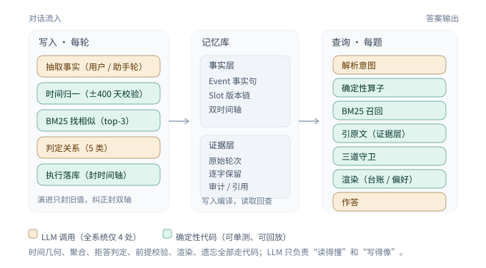

# LongMemEval 记忆系统 fusion：框架与进展简报

2026-11-14 · 当前代码 v3.21（Oracle）/ v3.9.1（S 档）· 全链路 glm-5.2
代码：`memory_sys/`（fusion / schema / bm25 / lifecycle / llm_io）· 入口：`cli.py`

---

## 一、框架

**要解决的问题。** LongMemEval 每道题给一座独立对话库：Oracle 约 6.6k tokens/题，S 约 122k tokens/题、48 个 session。要回答六类问题——单会话事实、偏好、助手侧事实、知识更新、时序、多会话聚合，外加 30 道拒答。我们不训练模型，只决定记什么、怎么记、怎么取。

**主张。** 对话进来先编译成两层：**事实层**（事实 + 版本链 + 双时间轴）和**证据层**（原始轮次逐字保留）。答题时先在事实层算，再回证据层找原话。全系统只有四个地方调用 LLM——抽取、判关系、解析问题、写答案；其余都是代码，可单测、可回放。

*图 1　十二个步骤里只有四处调用 LLM（琥珀色），其余全部是确定性代码（青色）。*

**记忆长什么样。**

- `Event`：一条事实 = 主语 / 谓词 / 值 + 原句 + 两个时间（何时为真、何时被说）。
- `Slot`：同一组主谓的版本链，能回答“现在是多少”，也能回答“上个月是多少”。
- `Store`：全部事件 + 原始对话，用于审计和逐字引用。

**写入：一轮对话走五步。**

1. **抽**——用户轮抽事实句；助手轮只抽专名（教学型事实必抽，选项列表不抽）。
2. **定时**——“上个月 / 两周前”先用规则换算，模型兜底，±400 天以外判为幻觉。
3. **找相似**——BM25 取最像的 3 条旧事实。
4. **判关系**——新事实 / 合并 / 演进 / 纠正 / 补充。
5. **落库**——演进只封旧值的有效时间（历史仍可查）；纠正连陈述时间一起封（旧值从未为真）。

举个例子：用户先说“I have 30 coins”，后说“I now have 38 coins”，判为演进；问“现在多少”答 38，问“上个月多少”仍答 30。

**查询：一道题走六步。**

`解析意图 → 走算子 → BM25 召回 → 引原文 → 过守卫 → 渲染并作答`

算子是确定性的：计数、求和、现值、某时刻值、事件列表、最大值、第 N 项直取、算术注记。守卫三道：信息不足按标准句式拒答；问题里的专名用户从未提过，判假前提；建议类问句豁免、改给提示。

**S 档多一层。** 记忆库超过 100 条才触发：实体倒排找“一跳相关”的事件补进候选，单独成段、不参与主排序。48 题试点 72.92 → 89.58。

**三条原则，每条对应一次踩坑。**

1. 数字要么全对，要么明说不可信（v3.1 加性渲染 -1.4pp 回滚）。
2. 检索可以退化，不能丢失（BM25 + 原文地板）。
3. 规则要匹配问句形态（PREMISE CHECK 误杀建议类问句，加豁免后修复）。

## 二、当前测试效果

**主结果（同一 judge、同一数据版本；2026-11-14，四轮）**

| 设定 | 系统 | 轮数 | 分数 |
| --- | --- | --- | --- |
| Oracle 500 | 全上下文基线（上界探针，禁作交付） | 4 | **87.90 ± 0.84** |
| Oracle 500 | **fusion v3.21（当前代码）** | 4 | **89.80 ± 0.23** |
| **Oracle test 249** | 基线 / fusion | 4 / 4 | 88.45 / **88.65**，配对 **+0.20pp**（CI −3.6…+4.1，p=0.50） |
| Oracle dev 251 | 基线 / fusion | 4 / 4 | 87.35 / 90.94，配对 +3.59（CI −0.7…+7.8） |
| S 档 48 题 | fusion v3.9.1（开一跳扩展） | 1 | **89.58** |

**主数字用 test 的 88.65 ± 0.38**。全体 +1.9pp 里，增量几乎都落在调参用过的
dev（+3.6）；到没碰过的 test 只剩 +0.2。所以口径只能是"与上界**统计打平**"，
不是"超过"。反过来说，四轮极差只有 0.4pp，比基线自己的 1.8pp 还小——系统
已经比它的对照组更稳。

**分题型：两胜一平四负（Oracle 500 四轮均值；括号内为 test Δ）**

| 题型 | 基线 | v3.21 | Δ |
| --- | --- | --- | --- |
| temporal-reasoning | 81.95 | **89.66** | **+7.71（+7.20）** |
| single-session-preference | 87.50 | **89.17** | **+1.67（+3.33）** |
| multi-session | 79.89 | **82.89** | +3.01（+0.38） |
| 拒答 _abs（30 题） | 78.33 | 79.17 | +0.83（0.00） |
| single-session-user | 97.86 | 97.14 | −0.71（0.00） |
| knowledge-update | 94.23 | 93.27 | −0.96（−5.13） |
| single-session-assistant | 100.00 | 92.86 | −7.14（−10.71） |

**消融（每次只关一个机制，全量 500 题，当前代码）**：关证据地板 **−3.6pp**
（最大单机制；TR −7.7、MS −4.7）；关句子级摘录 −1.6pp（SS-A −3.6）；宽口径
前提校验 −1.0pp；关算术注记 −0.6pp（噪声边缘）。与旧报告不同，地板从"冗余"
变成了"主路径之一"——v3.20 收紧抽取后，事实层覆盖下降，原文兜底更吃重。

**成本 / 延迟（实测 + 调用计数估算）**：写入 ≈22 s/题（Oracle，14–17 次串行调用）、
≈14 min/题（S 档，344 次）；读取 p50 2.3 s（S 档实测，含作答），Oracle 检索
p95 11.3 ms；token 写入 ≈8.9 M/500 题，答题 2.4k/题。端点在时，**冷缓存全量
重建 3 h 58 min，热缓存重答一轮 139 s**——后者让多轮方差变成常规操作。

**诚实声明**：judge 为 glm-5.2 代跑官方提示词，不是官方 GPT-4o；同一批答案
重复判分 500/500 逐题一致（可复现），但口径偏差只能由官方复跑校准。S 档 n=48，
95% CI ±9.1pp，不能与 500 题成绩直接等同。

---

## 三、主要疑惑

### 3.1 时间开销：慢在写入，但还没定位到具体哪一段

现状：写入 ≈22 s/题（Oracle，14–17 次调用，≈1.0 s/轮）、≈14 min/题（S 档，344 次，≈1.7 s/轮），写入占 token 的 87%；读取 p50 2.3 s、检索 p95 11.3 ms，读侧已不是瓶颈。S 档 haystack 只有 Oracle 的 18.5 倍，写入时间却是 38 倍——多出来的是调用次数（22 轮 → 494 轮）带来的固定开销。

- **没有拆过账**：抽取 / assistant 专项 / 关系分类 / 解析各占多少调用与 token，未做 profile；批量化上限、先砍哪段只能估。要不要先花 1 天分段计时？
- **该用哪个指标**：若按离线 ingestion 叙事（一次写入、多次查询），per-question 写入时间不该是主指标，read p50 2.3 s 才该是；两条口径混报容易被问“到底快还是慢”。
- **并发上限未知**：“不提并发”是为可比性做的自我约束，不是端点限制。若端点能撑 8 并发，S 全量从 117 h 降到 ~15 h，后面所有取舍都要重算。要不要先测一次小样本吞吐？

### 3.2 横向：主流记忆框架的时间开销（统一换算成 s/轮 · s/题）

口径：写入按“每对话轮”、读取按“每道题”。HaluMem 提供了同库同 harness 的全量耗时（30,073 轮 / 3,467 题），可直接换算；区间取 HaluMem 的 Medium / Long 两版（Long 插入了大量无关对话；部分系统反而处理更多记忆点，故用区间而非单值）。

| 系统 | 写入（s/轮） | 读取（s/题） | 依据 |
| --- | --- | --- | --- |
| Mem0 / Mem0g（开源+云） | 0.8–5.5 / 1.0–5.7 | 0.7–1.1 | HaluMem 实测 |
| MemOS（开源） | 1.7–2.1 | 0.36 | HaluMem 实测 |
| Memobase | 0.27–0.59 | 2.4 | HaluMem 实测 |
| Supermemory | 0.55–1.9 | 1.7–2.4 | HaluMem 实测 |
| Zep / Graphiti（开源+云） | 异步，未测 | 0.87–0.92（HaluMem）/ 0.10（官方 p50） | 实测 + 自报 |
| LangMem / Letta / Cognee | LangMem ≈60（p95 单次抽取），其余未公布 | 0.10–0.30 / 0.05–0.15 | Mem0 复现 + 第三方 |
| Hy-Memory 2（开源） | lite 0.02（零 LLM）；pro 1.5–3.0 | 0.003–0.02（检索）+ 一次作答 | 本机 + 官方 |
| 闭源（ChatGPT / Claude / Gemini 记忆） | 未公开 | 未公开 | — |
| **fusion（本系统）** | **1.0–1.7**（22 s/题 Oracle、14 min/题 S） | **0.011 检索 / 2.3 含作答** | 本机实测 |

三点读法：① 归一后没有数量级差距：写入 0.02–5.7 s/轮、读取 0.05–2.4 s/题。此前“写入是检索 66 倍”是假象——写入算 30,073 轮、检索算 3,467 题，单位数差 8.7 倍，折算后仅 0.2–7.7 倍。② 我们写入处于中位（1.0–1.7 s/轮），读取 2.3 s/题偏高，但纯检索 11 ms 是最快的——差在答题生成，不在检索。③ Hy-Memory lite 的 0.02 s/轮是唯一低 50 倍以上的（零 LLM、纯向量 RAG）；pro 档回到 1.5–3.0 s/轮，与我们 1.0–1.7 重叠。

*注：HaluMem 检索只含召回、不含作答；Mem0 的“+0.6–0.9 s”只是单次抽取、不是整轮成本。来源：HaluMem Table 5/6、MemOS Table 7、Zep / Mem0 官方页、Hy 官网与本机实测。*

### 3.3 下一步方向：三条路只能选一条

| 方向 | 做法 | 预期 | 成本 / 风险 |
| --- | --- | --- | --- |
| A 提速 | 批量抽取 k=4–5 + assistant 合并 + 关系分块 | Oracle 7–9 s、S 3–5 min（约 0.3–0.6 s/轮，3–4×） | 1.5 周；改抽取粒度有掉分风险，Oracle 3 h/轮可配对验证、可回滚 |
| B 补分 | 补 KU / SS-A / SS-U 的 -17pp | 不确定 | 2 周；根因是信息压缩，可能要改召回结构，改动面最大 |
| C 补可信度 | S 档全量 500 题 + 官方 judge | 分数不变，可比性提升 | 117 h 机时 + judge 费用 |

倾向：**先 B 再 A**。新的消融结果把顺序改了——关掉证据地板掉 3.6pp、掉 18 题，
说明当前压缩率已经吃紧；A 的批量抽取会进一步削薄召回，省下的时间可能用分数换。
B 只碰 SS-A / KU（两项都有明确机理解释：助手轮只留专名、旧值缺原句语境），
C 只在需要对外比 S 档时做 100 题抽样。有三件事需要定：结项更看分数还是系统
可用性？是否有"必须跑满 S 档 500 题"的硬要求？剩余约 8 周按 B 2 / A 1.5 / C 1
周配比是否合适？
